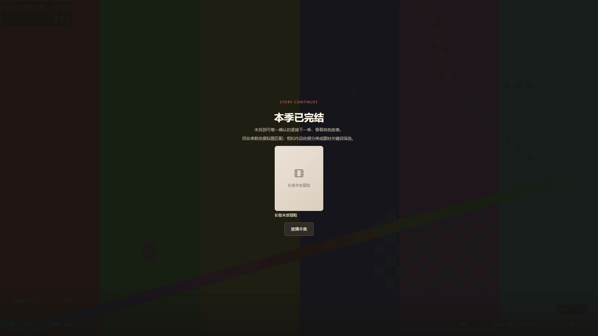
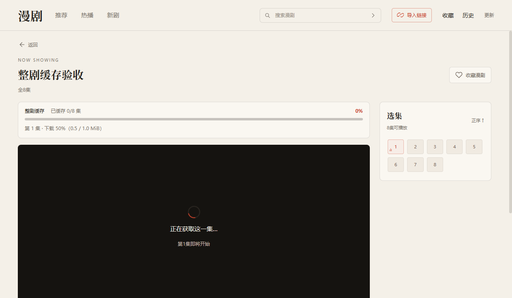
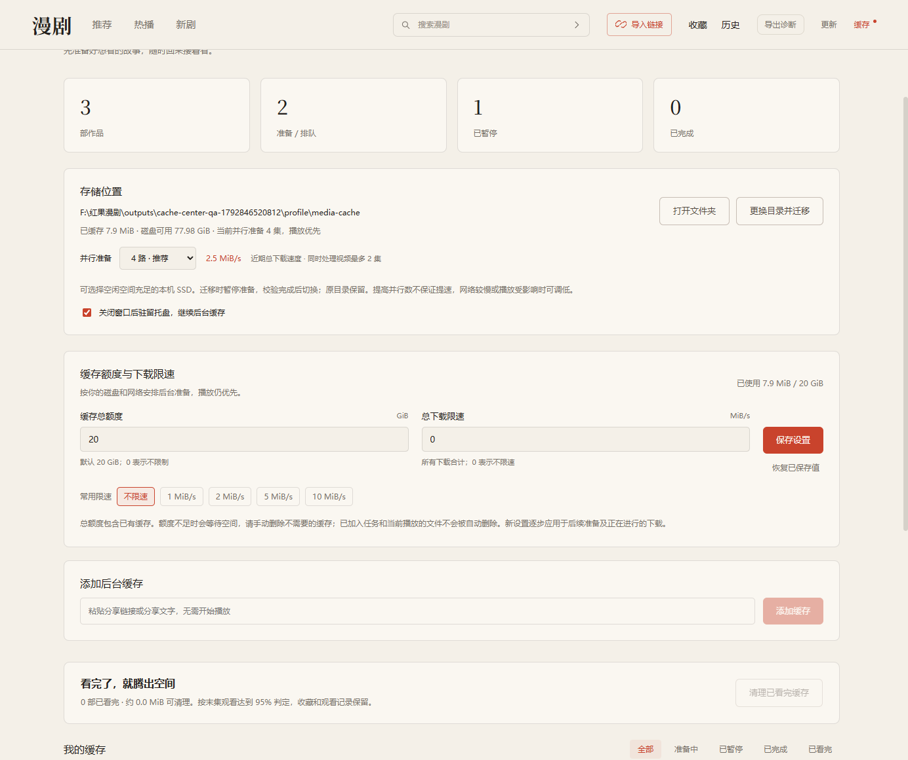

# 红果漫剧桌面版 · 非官方

在 Windows 电脑上找漫剧、导入分享链接，并接着上次的进度观看。使用 Electron + React + TypeScript 开发，支持 Windows 10/11 x64。

**[下载 Windows x64 安装包 · 0.6.1 测试版](https://github.com/lhljpt-web/hongguo-manju-desktop/releases/download/v0.6.1/Hongguo-Manju-0.6.1-Windows-x64.exe)** · [发布说明与校验文件](https://github.com/lhljpt-web/hongguo-manju-desktop/releases/tag/v0.6.1) · [安装指南](docs/installation.md)

0.6.1 在原生播放接口返回空响应时恢复官网公开可播分集，显示实际可用画质（当前抽查为 360p）。**全集尚未恢复**：部分分集官网返回 403，客户端明确提示，不用首集预览代替所选分集。保留外观、缓存、收藏和进度。[修复说明](docs/releases/v0.6.1.md)

0.6.0 新增四套可切换界面风格：默认「宣纸书卷」，以及「午夜影院」「流光」「像素放映厅」。顶部「外观」中选择后立即生效，保存在本机，随时可恢复默认；播放、缓存和观看记录不受影响。[外观更新说明](docs/releases/v0.6.0.md)

> 本项目是个人维护的第三方非官方客户端，与红果官方及其运营方没有隶属、合作或授权关系。相关品牌、作品、封面及其他内容的权利归各自权利方所有。

项目借鉴了渠道有数维护的 [hongguo-desktop（公开发行仓库）](https://github.com/waligoraamodio288-rgb/hongguo-desktop-releases) 的桌面端使用思路，并在研究其 TV 版请求结构后，实现了本项目的桥接与播放流程。感谢原项目提供的参考。本项目由本仓库作者独立维护，与原项目的发行、更新和反馈渠道分开。

Releases 提供 Windows x64 测试版安装包，仓库提供源码、测试和验证报告。独立「红果免费漫剧」APP 接入仍处于验证阶段，具体能力和限制见下文。

[界面预览](#界面预览) · [下载与安装指南](docs/installation.md) · [使用方法](#开始观看) · [常见问题](docs/installation.md#常见问题) · [发布页面](https://github.com/lhljpt-web/hongguo-manju-desktop/releases) · [问题反馈](https://github.com/lhljpt-web/hongguo-manju-desktop/issues)

## 界面预览

以下为 0.2.1 桌面程序在 2026 年 10 月 14 日验证时的实际界面截图。截图中的作品、封面与片单来自当时的内容来源，不代表当前始终可用。应用需要在 Windows 上运行；本仓库没有提供浏览器在线播放网站。

### 推荐首页

米白背景、朱红按钮，顶部切换推荐、热播和新剧，也可以搜索剧名或导入链接。


### 播放与选集

左侧按原比例播放，右侧选集；下方提供进度、音量、倍速、全屏和自动连播。


### 播放页下方推荐

0.4.0 优先查找同名后续季，再按分类和题材关键词推荐，支持重新获取。下图为实际桌面程序使用本地测试作品的验收界面，非线上作品。


### 跨季连播与完结推荐

0.5.0 看完当前季后可自动衔接唯一匹配的下一季；找不到可确认的后续季时，在全屏画面内显示可点击的相似题材。下图是实际桌面程序的本地测试作品，只有一部符合题材的候选，因此显示一张卡片。



### 缓存进度

0.2.11 在播放器上方显示整剧进度条、已缓存集数和完成百分比，下面显示当前集的下载或处理进度。全屏时进度跟随控制栏显示和隐藏。下图为真实桌面程序使用本地八集测试视频的验收界面，非线上作品。



### 后台缓存中心

支持 2/4/6 路并行、速度、暂停、重试、迁移、托盘缓存及清理。下图是 0.4.0 桌面程序的本地三部测试作品，非线上片单。


0.5.0 增加保留额度、总下载限速和作品优先级。以下为新版本实际缓存设置界面，使用本地测试任务。



### 启动更新提示

0.3.1 检测到新版后弹出提示。选择「暂不更新」不下载，点击「立即更新」才下载，下载完成仍需确认「重启安装」。下图使用本地无害更新源，示例版本 0.3.2 仅用于测试，不代表已有该版本发布。


<details>
<summary>查看更多：继续观看与分享导入</summary>

验证过程中产生的观看记录会显示为首页的继续观看卡片，可直接回到对应作品。


分享导入窗口支持粘贴链接或整段分享文字，解析成功后自动加入收藏。下图截取自导入弹窗，输入框尚未填写。


</details>

## 下载前先看

| 项目 | 当前状态 |
| --- | --- |
| 系统 | Windows 10 / 11 x64；暂无 macOS、Linux 或 Windows ARM64 安装包 |
| 版本 | 0.6.1，测试版（Pre-release） |
| 安装包 | [Windows x64 · 约 174 MiB](https://github.com/lhljpt-web/hongguo-manju-desktop/releases/download/v0.6.1/Hongguo-Manju-0.6.1-Windows-x64.exe) |
| 源码 | 可通过本页绿色 Code 按钮 → Download ZIP 下载 |
| 运行依赖 | 源码包不含完整运行组件，仅下载 ZIP 无法直接观看 |
| 手机与账号 | 完整个人构建无需手机或模拟器；不接入手机账号与跨设备同步 |

普通用户下载 `.exe` 安装即可，详细步骤见 [下载与安装指南](docs/installation.md)。也可以从 GitHub 右侧 Releases 进入 0.6.1，在 Assets 中选择 `.exe`。GitHub 自动生成的 Source code ZIP 是源码，不是安装程序。

## 功能

- 浏览来源提供的推荐榜、热播榜和新剧榜，按剧名搜索作品。
- 导入分享链接，查看作品详情和剧集列表，并加入本地收藏。
- 播放页下方优先推荐同名后续季，再展示相似题材；唯一匹配的紧接下一季自动加入后台缓存。开启自动连播后，末集结束自动从下一季首集播放，保持全屏与倍速。
- 没有可确认的下一季时，在结束画面展示至多六部相似题材，点击后播放；关闭连播或睡眠停止时不自动切换。
- 播放、选集、进度拖动、音量、倍速、全屏、上下集和自动连播。
- 默认最高画质，也可选择来源实际档位；保存倍速、音量、静音和自动连播设置。支持画中画、按分钟或再播 N 集停止。
- 当前集优先准备，再后台逐集缓存整部作品；显示整剧进度条、集数、百分比及当前集下载或处理进度，重开可复用。
- 缓存中心可同时登记多部作品，默认四路并行准备，可选两路或六路，支持暂停、继续和重试；关闭主窗口驻留托盘，重开接着缓存。
- 每部作品支持确认删除缓存释放磁盘空间，另可一键清理已看完作品；收藏和历史保留。
- 自选缓存位置、校验迁移完整缓存和断点；支持经强 ETag 校验的断点续传、缓存预算、总下载限速和作品优先级。兼容源尝试边下边播。
- 支持「宣纸书卷」「午夜影院」「流光」「像素放映厅」四种界面风格；顶部「外观」切换立即生效并保存在本机，可随时恢复默认。
- 点击「导出诊断」保存本次运行的阶段耗时与错误码，不含媒体地址、密钥或用户目录。
- 保存本机收藏、最近观看和播放进度，退出重开后继续观看。
- 启动约 2 秒后检查更新，发现新版弹出居中提示；点击“立即更新”才下载，下载完成后点击“重启安装”升级。

推荐与榜单来自内容来源；收藏和观看记录保存在当前电脑。首版不接入手机账号，也不同步手机个性化推荐。下载导出、评论和签到福利暂未提供。

## 安装使用

从 [0.6.1 发布页面](https://github.com/lhljpt-web/hongguo-manju-desktop/releases/tag/v0.6.1) 下载 `Hongguo-Manju-0.6.1-Windows-x64.exe`。下载源码 ZIP 后不能直接运行应用。

安装包包含精简 Java、签名桥接和 FFmpeg，不需要另行安装 Node、Python、Java、手机 APP 或 Android 模拟器，也不需要手动启动服务。

双击 `.exe`，按向导选择安装目录，安装完成后从桌面或开始菜单启动「红果漫剧桌面版」。逐步操作、文件校验、升级和卸载说明见 [安装指南](docs/installation.md)。

0.3.0 使用米白背景、墨黑文字和朱红点缀，首页包含顶部导航、宽幅作品推荐和继续观看卡片。顶部可切换三个榜单或搜索剧名；推荐区下方圆点可切换作品，收藏按钮收藏当前作品。首页最多显示三部最近观看作品，点击后接着看。

0.6.0 把界面外观独立出来：默认仍是「宣纸书卷」，另提供「午夜影院」「流光」「像素放映厅」；在顶部「外观」中可预览并切换，选择保存在本机，随时可恢复默认。切换只影响配色与排版，不会改变播放、缓存或观看记录。

点击「导入链接」粘贴链接或包含链接的分享文字，导入后自动收藏。播放器支持进度、音量、倍速、全屏和上下集；全屏播放时控制栏闲置约 2.5 秒自动隐藏，移动鼠标后显示，暂停时保持显示。手动上下集与自动连播会保持全屏；视频按原比例显示。支持渐进处理的片源可边缓存边播放，其余片源先完整准备；流式阶段只能定位到已经缓冲的位置，完成后可正常拖动。仍可能受网络或转码速度影响而等待，不能保证二倍速始终无卡顿。

**跨季与完结推荐**：仅标题主体相同、季数正好加一且结果唯一时衔接，缺季、重名版本或无明确季数不猜测。确认的下一季会自动登记为后台缓存，缓存中心可暂停或移除。自动连播开关控制播放切换；睡眠计划会停止播放，但不会取消已登记的后台缓存。没有后续季时，结束画面提供相似题材卡片，需点击播放。

**缓存策略与播放偏好**：缓存中心默认保留额度 20 GiB，0 表示不限，可设总下载 MiB/s 和每部作品优先级。额度控制保留的媒体与断点，不是整个应用目录的硬上限；处理中另需临时磁盘空间。达到额度会暂停新准备，清理空间或调高额度后重试。断点仅在资源指纹与强 ETag 一致且服务器正确响应 Range 时复用，否则从头准备。画质优先选不高于所选档位的最高可用源，没有更低档时选来源最低档；显示的是实际源画质，不会补造高清。睡眠定时仅本次运行有效，画中画取决于系统支持。

**后台缓存**：打开作品后点「缓存当前整季」，或进入顶部「缓存」粘贴分享内容、从收藏选择作品。已登记任务在离开页面、换作品、最小化和关闭到托盘后继续；每部作品显示进度，可暂停、继续、重试或移除。全局默认同时准备四集，可选两路或六路；最多同时处理两集视频，作品轮转，当前播放优先。托盘菜单「退出软件」才会停止任务；重开复用完整文件并继续未暂停的任务。关闭到托盘会暂停视频，不会后台连播。没有加入队列的临时提前缓存离开详情页后停止。

**清理缓存**：缓存中心“删除缓存”会停止对应任务、删除本地媒体并保留收藏和历史；“清理已看完缓存”按末集进度达到 95% 筛选并确认，不代表逐集观看核验。当前打开作品需离开详情后再删。普通播放缓存也会列出，旧版未登记的作品重新打开一次即可补充清单。

**存储位置**：缓存中心显示目录、缓存占用和可用空间。「更换目录并迁移」将所选位置下的专用 `HongguoManjuCache` 目录作为目标；目标须为空。迁移会暂停准备、复制并校验完整文件与可续传的断点，成功后切换；旧目录保留，确认新目录正常后可自行清理。默认沿用原 `media-cache`，升级不强制搬动。选择本机 SSD 可避免慢盘瓶颈，但不能保证网络或转码提速。

已登记作品及当前作品的完整缓存不受原 1 GiB 清理目标淘汰，重开保留；移除任务仅取消登记、保留文件，但文件之后可按大小、年龄和空间需求清理。新准备前按 2/4/6 路分别预留约 1.6/2.2/2.8 GiB 可用空间，不足时暂停并提示，可清理空间后重试。兼容 H.264 片源优先无损封装，失败回退编码，HEVC 等仍需转码；原始视频轨道可能比重新编码占更多磁盘。全剧缓存会使用相应流量和磁盘，不提供导出；不能保证消除解码或渲染造成的卡顿。

记录与默认缓存位于 `%APPDATA%/红果漫剧桌面版/`，其中 `library.json` 保存收藏和观看位置，`player-profile.json` 保存本次安装的固定播放标识，`cache-settings.json` 保存缓存任务与自选目录。卸载默认保留个人记录。完整损坏的记录文件会先备份为 `library.json.corrupt-*`；单条坏记录会过滤，其余记录保留。

应用从本仓库 GitHub Releases 获取更新（含测试版）。启动约 2 秒后检查，运行期间每 4 小时检查；发现新版后弹出居中提示，同一版本在本次运行中只自动提醒一次，点击「立即更新」才下载并校验；选择「暂不更新」可继续使用当前版本。点击顶部「更新」可查看状态、重试或「重启安装」。普通退出不安装更新。0.2.2 及更早版本需先手动安装一次 0.5.0；0.2.3 仍采用旧的自动下载行为，要避免后台下载可直接手动覆盖安装本版。升级保留收藏、进度和播放标识，详见 [更新说明](docs/auto-update.md)。安装包尚未配置 Windows 发布者代码签名。

## 开始观看

1. **从首页选剧**：在顶部切换推荐、热播或新剧，点击作品卡片进入详情，再点击播放或右侧集数。
2. **搜索作品**：在右上方搜索框输入剧名并提交，核对结果的完整标题和季数后打开作品。
3. **导入分享**：在手机端复制作品分享内容，点击桌面端「导入链接」，粘贴链接或整段文字，再点「导入并收藏」。
4. **控制播放**：拖动进度条定位，调整音量和倍速；点击全屏按钮放大画面。右侧可选集，下方可开关自动连播。
5. **接着上次看**：下次启动时点击首页的继续观看卡片，或从「历史」打开作品。「收藏」保存的是作品列表。

首集会尝试渐进播放，无法渐进处理时回退完整准备，等待时间受网络、源格式和处理性能影响。加载失败时请按 [常见问题](docs/installation.md#常见问题) 排查；不要反复点击不同集数。

## 验证记录

0.5.2 自动连播闪黑、首帧衔接、快速跳集与重试见 [连播画面衔接验收](docs/frame-handoff-validation.md)。

0.5.0 跨季连播、渐进播放、断点、缓存策略、睡眠与偏好见 [连续观看验收](docs/continuous-playback-validation.md)。

0.4.0 推荐季数匹配、缓存并发、速度对比、单部和已看完清理见 [推荐与缓存验收](docs/recommendations-cache-validation.md)。基于成熟播放器整理的后续建议见 [体验审视](docs/player-improvement-review.md)。

0.3.1 启动弹窗、全屏层级、键盘操作及更新下载确认见 [启动更新验收](docs/startup-update-validation.md)。

0.3.0 的多作品后台缓存、托盘关窗继续、队列重启、目录迁移与速度对比见 [后台缓存验收](docs/background-cache-validation.md)。

0.2.11 增加可见进度条与单集下载、处理进度，见 [缓存进度验收](docs/cache-progress-validation.md)。0.2.10 将五集窗口改为整剧提前缓存，含失败恢复和空间暂停，见 [整剧缓存验收](docs/full-series-cache-validation.md)。保留 0.2.9 的清晰度选择、倍速记忆及官方搜索页面改版后的搜索修复，支持按来源分页加载。搜索词最多 30 字，结果可能包含近似匹配作品，请核对标题和季数。见 [搜索修复记录](docs/search-fix-2026-10-23.md)。

0.2.7 修复旧播放接口空响应及新版嵌套资源格式兼容，已验证完整连续播放和后续集数，见 [2026-10-22 检查与修复](docs/health-check-2026-10-22.md)。0.2.6 及更早版本出现此问题时，请升级当前版本。

0.2.2 修复播放请求空响应及部分集数编码不兼容，见 [故障排查与修复](docs/playback-incident-2026-10-18.md)。

阶段一已抽查两部作品共十集，核对正片时长并完整播放到结尾，详见 [播放验证报告](research/NATIVE-REPORT.md)。桌面版验证见 [桌面验收记录](docs/desktop-validation.md)；0.2.1 的界面、播放和安装验证见 [版本验收记录](docs/bc-ui-validation.md)。原始机器记录保存在本机，未上传到仓库。抽样通过不代表所有作品和剧集均已验收。

独立「红果免费漫剧」接入实验见 [验证报告](docs/independent-app-validation.md)。使用独立 APP 的 `com.kylin.read` / `aid=8704` / `app_name=kylin_read` 身份，已验证分享导入、两部作品共十集完整播放及漫剧榜单进入新作品播放。原生搜索和独立首页尚未通过，签名组件仍复用已有 SDK；这些实验尚未替换正式客户端的接入实现，不能将当前版本称为完全独立接入。正式搜索仍来自红果短剧网页搜索页。

## 开发与重建

开发需要 Windows x64、Node.js 22+。完整个人构建的运行依赖位于安装目录的 `resources/runtime-bundle`；重建时需将已准备好的运行组件放入源码根目录的 `runtime-bundle`。组件清单和准备条件见 [运行组件说明](docs/runtime-components.md)。

**Linux 与网页版**：0.6.1 起源码支持在 Linux 上运行。`npm run runtime:linux` 准备跨平台运行组件（自动下载 unidbg 依赖并编译签名桥），`npm run web` 可在浏览器中使用与桌面版一致的界面（无需 Electron），`npm start` 可在 Linux 桌面运行 Electron 版本。搜索、播放资源与官网兼容回退三条通道无需签名 SDK；榜单、剧集详情与分享导入需要自行提取签名 SDK，步骤与差异见 [网页版运行指南](docs/web.md)。

Git 源码目录包含源码、文档、截图、测试和整理后的验证报告；安装包单独放在 Releases，源码 ZIP 不含完整运行组件或媒体缓存。`npm ci` 后可以执行测试、类型检查和构建；从源码启动播放需要准备上述运行组件。静态 APK 研究脚本还需要另行准备官方 APK 和 Python androguard 环境，原研究数据不随源码上传。

下载源码后，先安装依赖并执行自动检查：

```powershell
npm ci
npm test
npm run typecheck
npm run build
```

只有准备好完整 `runtime-bundle` 后，才运行应用或打包：

```powershell
npm start
npm run package:win
```

从下载 ZIP、打开终端到检查运行组件的完整步骤见 [源码运行指南](docs/installation.md#从源码运行适合开发者)。

修改 `runtime/SignerBridge.java` 后，设置 `HONGGUO_JDK` 为完整 JDK 17+ 目录并运行 `node scripts/rebuild-bridge.mjs`；它利用已有运行组件的依赖重新编译桥接类。`npm run runtime` 是原研究环境的完整运行组件准备脚本，需要 `docs/runtime-components.md` 中记载的输入快照，不是自动下载器。

`src/main/provider.ts` 提供榜单、搜索、分享解析、剧集与播放资源能力；`transport.ts` 管理签名子进程，`media.ts` 负责媒体准备与本地 Range 协议，`library.ts` 原子保存记录。`src/renderer/` 只调用有限的 preload API，不能获取签名或内容密钥。`src/probe/` 与旧探测脚本是阶段一研究工具。

## 参考与致谢

- [渠道有数 · hongguo-desktop](https://github.com/waligoraamodio288-rgb/hongguo-desktop-releases)：桌面端功能组织和 TV 版请求结构的研究参考。该仓库提供发行文件与反馈入口，不公开应用源码；本项目不是其源码分支，也不代表原作者的发行版本。
- [wofanqiang/hongguo-monorepo](https://github.com/wofanqiang/hongguo-monorepo)：多端架构和内容接入流程的研究参考。
- [zhenyong97/hongguo-downloader](https://github.com/zhenyong97/hongguo-downloader)：搜索、详情和原生接口的研究参考。

研究时核对的来源与许可状态见 [来源记录](research/sources.json)。未将许可不明确的研究仓库业务类打入正式应用。历史接入失败记录保留在 `research/`，应结合后续验证报告阅读。

## 项目声明与许可

本项目用于个人使用与技术学习。作品和媒体资源由上游内容服务提供，仓库不存储或分发剧集文件；播放缓存仅保存在本机。使用时请遵守内容来源的服务条款和适用法律，尊重相关权利方的权利。

内容和播放可用性取决于上游接口及网络环境，接口变化可能导致搜索、榜单或播放失效。项目不承诺全部作品可用，也不承诺长期兼容。

自有源码采用 GPL-3.0-only，见 [LICENSE](LICENSE)。第三方运行组件保留各自许可；项目许可证不授予任何作品、品牌或第三方 SDK 的使用与分发权。当前 Android 签名 SDK 的再分发许可尚未核实，安装包发布不表示该事项已解决，详见 [运行组件说明](docs/runtime-components.md)。

## 问题反馈

使用或重建本项目时遇到问题，可在 [本仓库 Issues](https://github.com/lhljpt-web/hongguo-manju-desktop/issues) 提交系统版本、应用版本、复现步骤和错误提示。请将本项目的问题提交到本仓库，避免混淆官方平台和参考项目的维护渠道。
