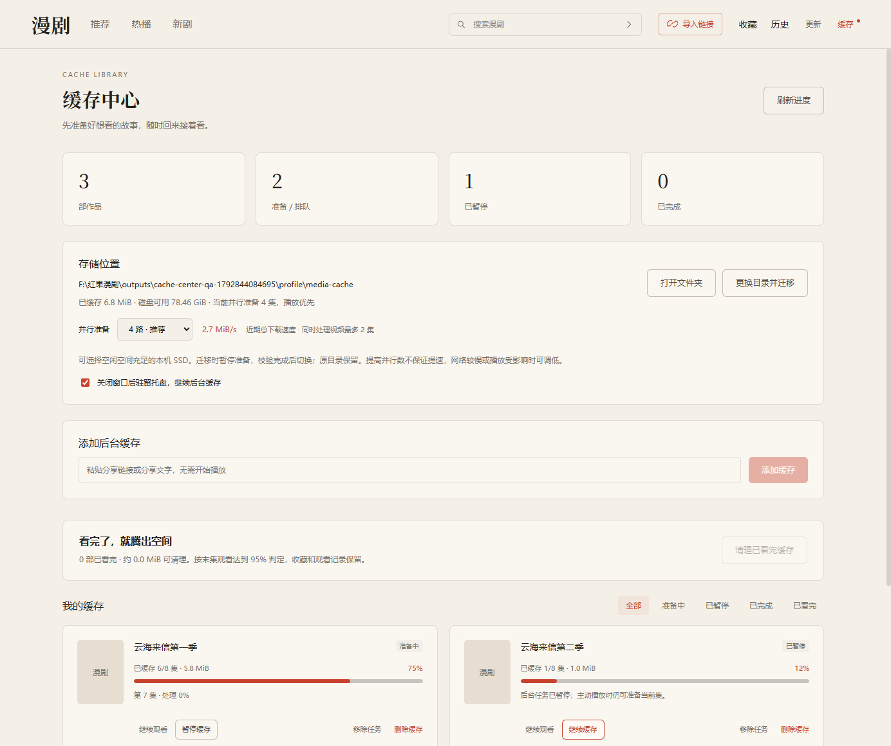

# 下载、安装与使用指南

[返回项目首页](../README.md) · [查看界面截图](../README.md#界面预览) · [发布页面](https://github.com/lhljpt-web/hongguo-manju-desktop/releases)

## 先确认下载状态

0.6.1 Windows x64 测试版已提供安装包、源码归档和 SHA-256 校验文件。

**[直接下载 Windows x64 安装包](https://github.com/lhljpt-web/hongguo-manju-desktop/releases/download/v0.6.1/Hongguo-Manju-0.6.1-Windows-x64.exe)** · [发布页面与校验文件](https://github.com/lhljpt-web/hongguo-manju-desktop/releases/tag/v0.6.1)

普通用户选择 `.exe`，下载后双击安装即可。Source code ZIP 或 Code → Download ZIP 得到的是开发源码，不能双击安装。此版本为测试版，仍有 [已知限制](releases/v0.6.1.md)。

0.6.1 会在原生播放接口返回空响应时，使用官网公开兼容播放资源。兼容源当前抽查为 360p，画质菜单显示实际值。**全集尚未恢复**：部分分集官网返回 403，应用会明确提示，可稍后重试或使用官方 APP 查看。已有高画质缓存仍可继续使用。

## 系统要求

| 项目 | 要求或说明 |
| --- | --- |
| 系统 | Windows 10 / 11，x64（64 位） |
| 网络 | 获取榜单、搜索、作品详情和播放内容需要联网 |
| 磁盘 | 需留出整剧媒体缓存空间；按 2/4/6 路分别预留约 1.6/2.2/2.8 GiB 可用空间，不足时暂停缓存 |
| 手机 | 完整个人构建运行时不需要手机或 Android 模拟器 |
| 开发环境 | 完整安装包不需要额外安装 Node.js、Python 或 Java |
| 其他平台 | 暂未提供 macOS、Linux 或 Windows ARM64 安装包 |

可在 Windows「设置 → 系统 → 关于 → 系统类型」核对设备是否为 x64。项目做过本机安装与隔离运行环境检查，尚未在全新的无开发环境 Windows 电脑上完成验证。

## 在 GitHub 哪里找安装包

1. 打开 [本仓库](https://github.com/lhljpt-web/hongguo-manju-desktop)，核对地址中的账号为 `lhljpt-web`，仓库名为 `hongguo-manju-desktop`。
2. 电脑宽屏页面通常在右侧显示 Releases；窗口较窄时位置可能变化，也可直接进入 [发布列表](https://github.com/lhljpt-web/hongguo-manju-desktop/releases)。
3. 打开 0.6.1 测试版，展开 Assets，选择 `Hongguo-Manju-0.6.1-Windows-x64.exe` 安装附件。
4. `.exe` 是 Windows 安装程序；`latest.yml` 是软件自动更新所需的元数据，普通用户不用打开；`SHA256SUMS-0.6.1.txt` 用于手动校验文件。Source code (zip) 和 Source code (tar.gz) 是 GitHub 自动提供的源码归档。

此版本标记为 Pre-release（测试版）。如果没有显示在 Latest 入口，请直接进入 [0.6.1 发布页面](https://github.com/lhljpt-web/hongguo-manju-desktop/releases/tag/v0.6.1)。

## 安装程序

1. 保存 `Hongguo-Manju-0.6.1-Windows-x64.exe`。文件约 174 MiB，下载或复制时需等待文件完整写入。
2. 如果同时取得 `SHA256SUMS-0.6.1.txt`，可以按下一节核对文件摘要。
3. 双击 `.exe`，按安装向导选择安装目录，再执行安装。
4. 完成后从桌面快捷方式或开始菜单启动「红果漫剧桌面版」。
5. 进入首页后等待榜单载入，点击作品，再进入播放或选择指定集数。

此个人构建尚未配置 Windows 发布者代码签名。若系统提示未知发布者，先核对文件来源和摘要；摘要只能证明文件一致，不能代替发布者身份认证。不需要关闭系统防护。

### 可选：核对文件摘要

在安装文件所在文件夹打开 PowerShell，执行：

```powershell
Get-FileHash -LiteralPath '.\Hongguo-Manju-0.6.1-Windows-x64.exe' -Algorithm SHA256
```

安装包摘要见对应发布页面的 `SHA256SUMS-0.6.1.txt`，对照同版本文件逐字符核对结果；十六进制字母大小写不影响比较。同版本如果重新构建，应以对应附件同时提供的校验文件为准。

## 首次打开后怎么用

### 浏览与搜索

搜索关键词最多 30 字；结果来自官方搜索接口，可能包含近似匹配作品。结果下方出现「发现更多」时可继续加载下一页，上游暂不可用时可点击重试。

顶部「推荐」「热播」「新剧」切换不同榜单。点击作品卡片查看详情和剧集列表；搜索框可以输入完整剧名。对相近标题、不同季数或同名版本，请先核对作品名称，再播放。


### 导入分享链接

1. 在手机端打开作品的分享功能，复制链接或分享文字。
2. 在桌面端点击右上角「导入链接」。
3. 将内容粘贴到输入框，点击「导入并收藏」。
4. 解析成功后核对作品标题、集数和顺序，再开始观看。导入成功的作品会加入本地收藏。


导入只识别受支持的来源链接。链接失效或解析失败会显示错误，不会自动替换为其他作品。

### 播放、选集与续播

右侧点击集数切换剧集；播放器下方可暂停、拖动进度、调整音量和倍速，或进入全屏。倍速会记住上次设置，手动换集、自动连播、切换作品和重开软件都继续使用。全屏时控制栏浮在画面上，播放中闲置约 2.5 秒隐藏，移动鼠标可唤出；暂停或操作控件时保持显示。开启自动连播后，当前集结束时进入下一集；自动连播与手动上下集均保持全屏。按 Esc 或点击全屏按钮退出。支持的片源会尝试边缓存边播放，不兼容时回退完整准备。流式阶段只能拖到已经缓冲的位置，完成后正常定位。等待时间仍受网络和处理速度影响。


收藏和播放进度保存在当前电脑。下次打开后，可以从首页继续观看卡片或「历史」返回作品；收藏列表与观看历史不是手机账号同步数据。

### 播放页下方的推荐

同名其他季排在前面，优先展示后续季，然后显示共同分类或题材关键词匹配的作品。观看时能唯一确认的紧接下一季自动加入后台缓存；开启自动连播后，末集结束从下一季首集开始，保留全屏、倍速及音量。没有可确认的下一季时，在结束画面提供至多六部相似题材，点击播放。理由标在卡片下方；点击进入对应作品详情。找不到匹配时显示空状态，来源失败可以重新获取。季数按标题核对，请同时检查简介；这不是手机账号的个性化推荐。

### 后台缓存多部作品

1. 点击顶部「缓存」进入缓存中心。粘贴作品分享链接/文字后点「添加缓存」，也可从收藏下拉框选择作品；播放详情页另有「缓存当前整季」按钮。
2. 每部作品显示已完成集数、百分比、占用空间，以及当前集下载或处理进度。整体百分比按完整可播放的集数计算，不是总字节比例。
3. 可以同时添加多部作品，应用全局默认并行准备四集，可选两路或六路；最多同时处理两集视频，作品之间轮转，当前播放优先。单独「暂停缓存」「继续缓存」或「重试失败」，不会影响其他作品。
4. 默认关闭主窗口会隐藏到 Windows 通知区域托盘，视频暂停，缓存继续。点击托盘图标重新打开；右键菜单「退出软件（停止后台缓存）」彻底退出。重开软件会接着准备未暂停的任务，已经完成的文件直接复用。退出后没有后台服务，也不会开机自启。
5. 在“并行准备”选择 2/4/6 路，默认 4 路。右侧显示最近实际总下载速度；提高并发不保证提速，播放受影响时可调低。
6. 「移除任务」保留已完成文件，但取消保护，之后应用可能按空间需求清理这些文件。没有登记队列的临时提前缓存离开详情页后停止。



### 缓存额度、限速与播放偏好

缓存中心可以设置保留额度（默认 20 GiB，0 不限）和总下载限速（MiB/s，0 不限），每部已登记作品可选高/普通/低优先级。达到额度会暂停新准备；可删除不需要的缓存或提高额度后重试。额度控制保留媒体和断点，转码过程中还需额外临时空间。断点仅在强 ETag、资源指纹和服务器 Range 校验通过时续传，否则重下。

播放器「画中画」可开启小窗，能否使用以当前系统为准；「睡眠定时」可选择时间或再看 N 集停止。停止只影响播放，已登记后台缓存仍可继续。倍速、音量、静音、画质和自动连播保存在本机；睡眠计划不跨重启保存。画质选择使用来源实际档位，缺少更低档位时回退来源最低档。

出现问题可点击「导出诊断」，手动保存本次运行的阶段耗时和错误码 JSON，不含媒体地址、密钥或用户目录。反馈时同时描述具体操作和现象。

### 删除缓存，释放磁盘空间

- 每部作品的“删除缓存”会先确认，再停止任务并删除对应视频和索引；收藏、观看记录及其他作品保留。删除失败会明确提示，可重新尝试。
- “清理已看完缓存”批量清理末集观看达到 95% 的作品，并显示预估空间。这是末集进度推断，不等价于逐集观看核验；也可手动删除不需要的作品。
- 当前打开作品禁止删除，请先离开详情页。迁移时不能删除；共享分集会保留以供其他作品使用，实际释放空间可能小于估算。
- 普通播放产生的缓存也会显示为“仅本地缓存”，无需加入队列。旧版未登记作品映射的缓存，需要升级后再打开相应作品一次。
- “移除任务”保留文件，“删除缓存”才释放对应磁盘空间；这里清理的是磁盘占用，而不是运行内存。

### 更换缓存目录

在缓存中心「存储位置」点击「更换目录并迁移」，选择空间充足的位置，应用会使用其中的专用 `HongguoManjuCache` 子目录。请选择本机磁盘，优先 SSD，目标专用目录必须为空。默认仍沿用旧缓存位置，不会因升级强制迁移。

迁移期间暂停准备，复制完整文件和可续传断点并校验一致性，成功保存设置后再切换。失败继续使用原目录。原文件不会自动删除，确认新目录可以播放后再自行清理旧媒体文件，勿删除记录和播放标识。迁移不是把任意个人文件夹交给应用清理。

兼容 H.264 视频优先复用原始轨道进行封装，减少重复编码；失败后回退兼容编码，HEVC 等资源仍需转码。片源、网速、磁盘和 CPU 均会影响时间，更换目录不能保证解决所有加载问题。保留原始轨道也可能占更多空间。

## 升级、卸载与记录

0.5.2 起，更新前会等待后台组件实际退出，安装包也会检查并结束本安装目录内的遗留媒体/签名组件，保留完整缓存和有效续传断点。若旧版出现 `Failed to uninstall old application files ... : 2`，从系统托盘菜单选择「退出软件」，下载本页 0.6.1 安装包后覆盖原目录即可；无需删除缓存或先卸载。仍提示运行时，可重启电脑后再直接覆盖安装。错误码本身不能确定具体占用文件，详细验证见[更新与缓存保留验收](update-cache-shutdown-validation.md)。

0.2.4 起采用手动确认下载：启动约 2 秒后检查，发现新版弹出居中提示；同一版本在本次运行中只自动提醒一次，重开软件会再次检查并提醒。点击「立即更新」才下载，选择「暂不更新」不会下载。点击顶部「更新」查看进度，下载并校验完成后点「重启安装」，应用先保存观看记录，再升级并重新打开。收起面板可以继续观看；普通退出不安装更新。更新失败可在面板中重试，GitHub 无法连接时也可手动下载本仓库新安装包覆盖安装。

**0.2.2 及更早版本没有更新器，需先手动下载安装一次 0.6.1。** 0.2.3 仍采用旧的自动下载行为；如需避免它后台下载，请关闭旧版后手动覆盖安装本版。 此后无需每次访问网页下载；更新包含本仓库测试版。升级时保留相同的应用数据目录和安装路径，收藏、播放进度及播放标识会沿用。详见 [应用内更新说明](auto-update.md)。

卸载可在 Windows「设置 → 应用 → 已安装的应用」（不同系统名称可能略有差异）中找到「红果漫剧桌面版」并选择卸载。默认保留个人记录。

数据目录：

```text
%APPDATA%\红果漫剧桌面版\
```

`library.json` 保存收藏与观看位置，`player-profile.json` 保存本次安装的固定播放标识，`cache-settings.json` 保存缓存队列和目录设置；`media-cache` 是默认媒体目录，自选位置以缓存中心显示为准。升级保留这些设置，不通过删除或轮换播放标识处理内容服务错误。需要备份时，先从托盘彻底退出，再复制记录及设置。清理空间时不要误删观看记录；媒体损坏可在程序完全退出后仅清理媒体目录，下次会重新准备。

## 从源码运行（适合开发者）

### 1. 下载源码

在仓库首页点击 Code → Download ZIP，解压到本地文件夹。安装 Node.js 22 或更新版本，并在解压后的项目根目录打开 PowerShell；这里应能看到 `package.json`。

也可以使用 Git：

```powershell
git clone https://github.com/lhljpt-web/hongguo-manju-desktop.git
cd hongguo-manju-desktop
```

### 2. 安装依赖并检查

```powershell
npm ci
npm test
npm run typecheck
npm run build
```

上述步骤用于源码检查与编译；通过不表示已经具备连接内容服务的全部运行组件。

### 3. 准备运行组件

当前仓库没有自动补齐全部组件的下载器。需要先准备 [运行组件说明](runtime-components.md) 中的 Java、桥接类、依赖 JAR、SDK 和 FFmpeg，再形成下列目录：

```text
runtime-bundle/
├── java/bin/java.exe
├── classes/app/hongguo/runtime/SignerBridge.class
├── dependencies.jar
├── sdk/
│   ├── libmetasec_ml.so
│   ├── libc++_shared.so
│   └── ms_16777218.bin
├── ffmpeg.exe
└── notices/
```

已有完整本机个人构建时，可从安装目录的 `resources/runtime-bundle` 复制整个目录到源码根目录。仅安装系统 Java 或 FFmpeg 不能替代这套固定组件。`npm run runtime` 依赖原研究环境的输入文件，不能在全新电脑上直接自动下载完成配置。

### 4. 启动或打包

```powershell
npm start
```

准备好完整组件后，如需生成供本机使用的安装包：

```powershell
npm run package:win
```

输出在 `release/`。个人构建成功不等于所有第三方组件的公开分发许可已经确认，许可状态请查阅运行组件说明。

## 常见问题

| 现象 | 说明与处理 |
| --- | --- |
| 右侧没有找到安装包 | 直接进入 [0.6.1 发布页面](https://github.com/lhljpt-web/hongguo-manju-desktop/releases/tag/v0.6.1)，展开 Assets 并选择 `.exe`；不要下载 Source code ZIP 作为安装包。 |
| 下载了 ZIP，找不到可执行程序 | 这是源码归档。开发者可按上面的源码运行步骤操作，仍需准备完整运行组件。 |
| 更新提示旧版卸载失败，末尾为 `: 2` | 这是旧卸载器的失败码。先从托盘退出，再用 0.6.1 或更新的安装包覆盖原目录；无需清空媒体缓存。仍失败可重启后重试，并提供安装提示及 Windows 版本。 |
| 启动提示应用数据或运行组件无法读取 | 检查安装是否完整、应用数据目录是否可写；源码运行时还需检查 `runtime-bundle` 是否齐全。 |
| 首页为空、搜索失败 | 检查网络并重试。同一网络能打开网页，不代表所有内容接口都可用；也可能是上游接口变化。 |
| 分享链接导入失败 | 重新复制作品的原始分享内容，检查链接是否完整；仍失败时记录提示原文和作品标题。 |
| 点击播放后需要等待 | 先尝试渐进播放，不兼容的片源完整准备后起播；网络或处理慢仍会等待。持续失败时重试当前集，再换另一部对照，可导出诊断。 |
| 黑屏或中途报错 | 查看错误提示，手动重试当前集；若只在特定剧集出现，反馈作品、集数与操作步骤。 |
| 手机收藏和观看历史没有出现 | 首版只保存在本机，不接入手机账号，也不支持跨设备同步。 |
| 推荐内容与手机不同 | 榜单来自当前接入的内容来源，不是手机账号的个性化推荐。 |
| 这是独立漫剧 APP 的完整电脑版吗 | 尚不能这样称呼。正式客户端仍使用现有短剧/TV 接入，独立漫剧 APP 的原生搜索与首页未完成验证，详见 [接入报告](independent-app-validation.md)。 |

如果仍有问题，请到 [本仓库 Issues](https://github.com/lhljpt-web/hongguo-manju-desktop/issues) 提交 Windows 版本、应用版本、作品与集数、复现步骤、预期结果和错误提示。截图请遮住无关个人信息，不要提交账号凭据、签名或完整播放地址。

## 整剧提前缓存

播放器上方显示进度条、“已缓存 N/总集数”和完成百分比；按完整准备好的集数计算，当前集未处理保存完成不计入。下方另显示当前集的“下载 50%（已下载 / 总大小 MiB）”或“处理 50%”，获取资源和保存时显示对应状态。约每秒更新。全屏时在控制栏显示简短进度，闲置后随控制栏隐藏。

打开作品后先准备当前集，随后在后台逐集准备后续全部剧集，再补齐较早的集数。当前作品的全部剧集完成下载和兼容转码后，界面显示“已缓存 N/N 集”和“全剧已缓存”；失败的集数不会计入完成，可点“重试缓存”补齐。默认并行准备四集，可在缓存中心改为两路或六路；最多同时处理两集视频。跳到未缓存集时优先准备所选集，然后继续整剧队列。

即使暂停或关闭自动连播，停留在详情页内也会继续缓存并使用网络流量。想先缓存好再看，可暂停并等待“全剧已缓存”。未加入后台队列的临时提前缓存离开详情页后停止；已加入后台队列的作品在离页和关闭到托盘后继续，彻底退出会取消未完成任务。已完成的缓存保留，重开作品可以复用。单次作品列表最多 5000 集，单集上限 150 MiB。

默认缓存目录为 `media-cache`，自选位置以缓存中心显示为准。当前整剧受保护，允许超过原来约 1 GiB 的清理目标；换到另一部作品后，旧作品缓存可按大小、年龄和可用空间自动清理，不能作为永久下载归档。每次准备新集前按 2/4/6 路分别预留约 1.6/2.2/2.8 GiB 可用空间，优先清理其他作品缓存，仍不足时暂停并提示；现有缓存仍可播放，释放空间后可点击“重试缓存”恢复。临时下载与转码文件另需空间。

二倍速可能比后台准备更快，全剧完成前仍可能等待；全部就绪后可避免逐集下载和转码等待，但缓存不能保证消除解码、渲染或硬件性能造成的卡顿。它只用于应用内播放，不提供下载导出。验证方法见 [整剧缓存验收](full-series-cache-validation.md)。

## 清晰度

0.2.9 起按 1080p → 720p → 540p → 480p → 360p 的顺序选择来源提供且可解码的轨道，播放器显示实际选择的分辨率。只提供低清轨道的集数无法凭空变高清，也不把低清放大后标为高清。高清文件通常更大，首次准备和后台缓冲可能更久。

升级自 0.2.8 或更早版本时，旧画质策略产生的媒体缓存需要重新准备；0.2.9 的新画质缓存可直接复用。升级不影响收藏、观看进度和播放标识，新的高清缓存用于整剧提前缓存。
