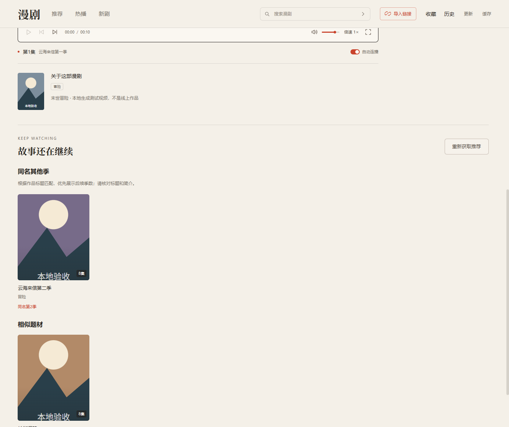

# 0.4.0 播放推荐与缓存管理验收

验证日期：2026-10-24，Windows x64。本地原始报告保存在 `outputs/`，不提交播放资源、签名和内容密钥。

## 线上推荐核对

实际内容来源返回《末世躺赢指南：到末世十年后第一季》，155 集；推荐首先查到《末世躺赢指南：到末世十年后第二季》，作品编号 `7697547853618482200`，其后得到 12 部具有末世/丧尸关键词关联的作品。

报告：`outputs/live-recommendations-1792843618422/report.json`。这次验证证明推荐能返回可核对作品，不表示重新完整播放验收了所有推荐作品。推荐卡片进入现有详情和播放流程，不替换片源。

同名其他季要求规范化标题主体一致，并核对明确的季/部数；后续季优先，排除当前季镜像和仅前缀相似的作品。题材推荐要求共同分类或受限关键词证据，泛称“漫剧”“男频”等不作为相似依据。查询有分页、候选和缓存上限，失败可重试，不阻塞当前播放。

## 并行缓存受控对比

脚本：`scripts/cache-throughput-qa.mjs`。真实 MediaCache 和 FFmpeg，12 个相同的 10 秒 640×360 H.264/AAC 本地生成视频，每次请求施加 700 ms 可控延迟。

| 并行准备 | 完成 12 集耗时 | 最大同时下载 | 最大同时处理视频 |
| --- | ---: | ---: | ---: |
| 2 路 | 5566 ms | 2 | 2 |
| 4 路 | 3285 ms | 4 | 2 |

该样本约提速 1.69 倍，耗时减少约 41%。这是网络等待占主要比例的受控测试，不是公网速度、HEVC 转码或所有电脑的性能承诺。默认 4 路，可选 2/4/6，设置持久保存；视频处理最多 2 路，当前播放能抢占后台处理，包括接管已经下载完、等待处理的任务。

## 实际 Electron 集成

脚本：`scripts/cache-center-qa.mjs`。只替换内容来源为本地生成的三部测试作品，保留正式主进程、preload、界面、缓存与 FFmpeg。最新通过报告：`outputs/cache-center-qa-1792844084695/report.json`。

- 推荐第二季排在前面，点击卡片进入对应作品；题材分组显示理由。
- 通过正式 IPC 切换 4→6→4，重启保持 4；24 个视频均准备成功，同时下载超过两路且没有超出配置。
- 多作品轮转、暂停/继续/失败重试、关闭到托盘继续缓存正常，晚到资源不触发隐藏窗口自动播放。
- 24 个文件迁移校验通过，旧文件保留；迁移后断网实际解码视频和声音，换集保持全屏与二倍速。
- 实际播到末集结尾写入已看状态；单部删除取消时文件保持，确认后真实移除 MP4 和 JSON、空间占用下降。
- 批量清理已看完作品保留未看完作品、收藏和历史；再次启动剩余 8 个文件可用，被删任务不复活、不重新下载。

界面截图中的《云海来信》《长街旧梦》是本地测试作品，非线上片单：




## 回归与限制

121 项自动测试（23 + 98）、类型检查及生产构建通过。覆盖季数匹配/去重、分页和缓存边界、故障隔离、并发上限、播放优先、定向删除、文件删除失败重试、播放保护、100 部队列容量和重启恢复。独立审查复核后未发现剩余 P1/P2 问题。

“已看完”按末集进度达到 95% 推断，不等价于逐集观看核验。当前打开的作品禁止删除，先离开播放详情再清理。普通播放产生的缓存可列出，不必加入后台队列；旧版本未登记作品映射的缓存，需要升级后重新打开相应作品一次。清理的是本地磁盘文件，不是内存；不提供导出下载。

并发越高，临时空间需求越大：2/4/6 路分别预留约 1.6/2.2/2.8 GiB。低空间暂停、迁移暂停和失败提示仍保留。完整单集准备后起播的机制尚未改变，首集仍可能等待。

## 打包与更新回归

Windows x64 NSIS 安装包生成成功，运行组件与 SDK 校验通过；更新清单版本、文件名和 SHA-512 已与安装包核对。最终 ASAR 内 5 个生产构建文件逐一与 dist 字节比对一致，package 版本为 0.4.0。

安装包大小：181820945 字节（约 173.4 MiB）。SHA-256：

```text
df61d088722ad20a2cf842b7093a1914949a61285dd193be18b9f2fb58d960b6
```

隔离打包客户端的更新回归通过：启动提示时不请求安装文件，暂不更新、Esc 和重开面板不下载；全屏层级和键盘焦点正常；重开重新提示，显式点击后只下载一次，仍等待安装确认。仅使用无害测试文件，未执行测试安装，未修改正式更新源。报告：`outputs/manual-update-qa-1792844268069/report.json`。尚未在全新、无开发环境的第二台 Windows 电脑复验本版。
